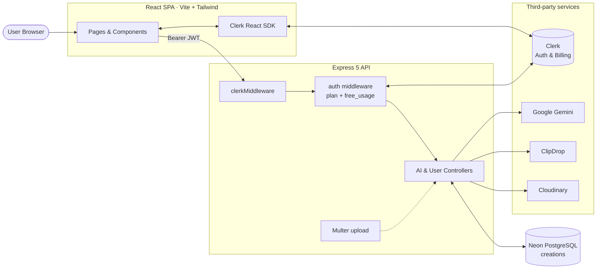
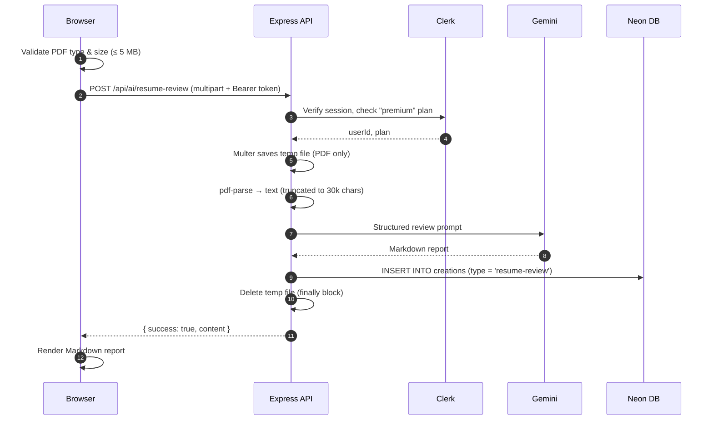

<div align="center">


# Vertexa — Full-Stack AI SaaS Platform

**An AI productivity suite that writes, designs, edits and reviews, built on the PERN stack with authentication, subscription billing and a community gallery.**

<p>
  
  
  
  
</p>
<p>
  
  
  
  
  
  
</p>

[Features](#-features) •
[Tech Stack](#-tech-stack) •
[Architecture](#-architecture) •
[API Reference](#-api-reference) •
[Getting Started](#-getting-started) •
[Deployment](#-deployment)

</div>

<!--
  OPTIONAL: add these once you have them.

  Live demo badge (place inside the badge block above):
  <a href="https://YOUR-LIVE-URL"></a>

  Screenshots: create docs/screenshots/ and add a section like:
  ## 📸 Screenshots
  | Landing page | Dashboard |
  |---|---|
  |  |  |
-->

---

## 📖 Table of Contents

- [Overview](#-overview)
- [Features](#-features)
- [Plans & Usage Limits](#-plans--usage-limits)
- [Tech Stack](#-tech-stack)
- [Architecture](#-architecture)
- [Project Structure](#-project-structure)
- [Database Schema](#-database-schema)
- [API Reference](#-api-reference)
- [Getting Started](#-getting-started)
- [Environment Variables](#-environment-variables)
- [Deployment](#-deployment)
- [Security Considerations](#-security-considerations)
- [Roadmap](#-roadmap)
- [Author](#-author)

---

## 🚀 Overview

**Vertexa** is a production-style, full-stack **AI SaaS application** that bundles six AI tools behind a single, polished dashboard. Users sign in, generate content with large language and image models, keep a personal history of everything they create, and can publish their image creations to a shared **community gallery** where others can like them.

The project demonstrates the pieces a real SaaS product needs, not just AI calls:

- 🔐 **Authentication & user management** with Clerk
- 💳 **Subscription billing & plan gating** (Free vs. Premium) with Clerk Billing
- 🤖 **Multi-provider AI orchestration**: Google Gemini, ClipDrop and Cloudinary AI
- 🗄️ **Serverless PostgreSQL persistence** with Neon
- 📁 **Secure file uploads** (images and PDFs) with validation and automatic cleanup
- ☁️ **Serverless-ready deployment** on Vercel (separate client and API projects)

---

## ✨ Features

### 🧠 AI Tools

| Tool | What it does | How it works | Access |
|---|---|---|---|
| **AI Article Writer** | Generates full articles on any topic in three lengths (short / medium / long). | Prompt → Google Gemini (via the OpenAI-compatible endpoint), token cap chosen from a server-side allow-list. | Free (metered) & Premium |
| **Blog Title Generator** | Returns 5 distinct, polished blog titles with a one-line rationale each, across 8 categories (General, Technology, Business, Health, Lifestyle, Education, Travel, Food). | Gemini with a system prompt that enforces a specific, non-repetitive editorial style. | Free (metered) & Premium |
| **AI Image Generator** | Creates images from a text description in 8 styles (Realistic, Ghibli, Anime, Cartoon, Fantasy, Photorealistic, 3D, Portrait). Optionally publishes to the community gallery. | ClipDrop text-to-image → uploaded to Cloudinary → permanent URL saved in PostgreSQL. | Premium |
| **Background Remover** | Removes the background from an uploaded image. | Upload (≤ 5 MB) → Cloudinary AI `background_removal` transformation. | Premium |
| **Object Remover** | Erases a named object (e.g. "watch", "spoon") from an uploaded image. | Upload → Cloudinary Generative AI `gen_remove` with a sanitized object prompt. | Premium |
| **Resume Reviewer** | Produces an ATS-aware, structured review of a PDF resume: executive summary, strengths, high-impact improvements, bullet rewrites, skills/ATS alignment and an action plan. | PDF text extraction with `pdf-parse` → Gemini with anti-hallucination and prompt-injection-resistant instructions. | Premium |

### 📊 Platform Features

- **Personal Dashboard**: total creations, active plan badge, and an expandable history of every generated item (Markdown-rendered text or image preview).
- **Community Gallery**: browse publicly shared AI images, hover to see the prompt, and **like / unlike** with optimistic UI updates and server-side reconciliation.
- **Authentication**: sign-in/sign-up, user profile and session management via Clerk; protected `/ai/*` routes.
- **Subscription Billing**: Clerk's `PricingTable` on the landing page and server-side plan verification on every request.
- **Responsive UI**: collapsible mobile sidebar, glass-style navbar, gradient hero, toast notifications and loading states throughout.
- **Robust UX**: client-side file size checks, input validation, graceful error toasts and spinner states.

---

## 💎 Plans & Usage Limits

Plan enforcement happens **on the server** (never trust the client) in a shared `auth` middleware.

| | **Free** | **Premium** |
|---|---|---|
| Article Writer | ✅ up to **10** combined uses | ✅ Unlimited |
| Blog Title Generator | ✅ shares the same 10-use quota | ✅ Unlimited |
| Image Generator | 🔒 | ✅ |
| Background Remover | 🔒 | ✅ |
| Object Remover | 🔒 | ✅ |
| Resume Reviewer | 🔒 | ✅ |
| Dashboard, history & Community | ✅ | ✅ |

> The free-usage counter is stored in each user's Clerk **private metadata** (`free_usage`), so it is tamper-proof from the browser and needs no extra database table.

---

## 🛠 Tech Stack

### Frontend (`/client`)

| Category | Technology |
|---|---|
| Framework | **React 19** |
| Build tool | **Vite 8** |
| Styling | **Tailwind CSS 4** (via `@tailwindcss/vite`), Outfit font |
| Routing | **React Router 7** (nested layout routes) |
| Auth & billing UI | **Clerk React** (`SignIn`, `UserButton`, `PricingTable`, plan-aware `Show`) |
| HTTP | **Axios** |
| Rendering AI output | **react-markdown** |
| UX | **react-hot-toast**, **lucide-react** icons |
| Linting | **Oxlint** |

### Backend (`/server`)

| Category | Technology |
|---|---|
| Runtime / framework | **Node.js** (ES Modules) + **Express 5** |
| Database | **PostgreSQL on Neon** via `@neondatabase/serverless` (parameterized tagged-template queries) |
| Auth | **Clerk Express SDK** (`clerkMiddleware`, `req.auth()`, plan checks via `has({ plan })`) |
| LLM | **Google Gemini** through the official **OpenAI SDK** pointed at Google's OpenAI-compatible endpoint |
| Image generation | **ClipDrop** text-to-image API |
| Image processing & hosting | **Cloudinary** (upload, background removal, generative object removal) |
| File uploads | **Multer** (disk storage, 5 MB limit, MIME allow-list) |
| PDF parsing | **pdf-parse** |
| Tooling | **Nodemon**, **dotenv**, **CORS** |

### Infrastructure

- **Vercel**: two projects (static SPA for the client, `@vercel/node` serverless function for the API)
- **Neon**: serverless Postgres
- **Cloudinary**: media CDN

---

## 🏗 Architecture



### Request lifecycle (example: Resume Review)



### Key design decisions

- **Server-side plan gating.** The `auth` middleware resolves the user's plan from Clerk on every request and attaches `req.plan` / `req.free_usage`; controllers decide what each tier may do.
- **Provider abstraction through one SDK.** Gemini is consumed via the OpenAI SDK, so swapping models/providers is a `baseURL` + `model` change.
- **Stateless, serverless-friendly API.** The Express app is exported for Vercel and only calls `listen()` when not running on Vercel (`process.env.VERCEL`).
- **Atomic likes.** Likes are stored as a `text[]` of user IDs and toggled in a **single SQL `UPDATE`** (`CASE` + `array_append` / `array_remove`), avoiding read-modify-write race conditions.
- **No orphaned files.** Uploaded temp files are always removed in a `finally` block, whether the request succeeds or fails.

---

## 📂 Project Structure

```text
Vertexa-Full-Stack-AI-SaaS-App/
├── client/                         # React + Vite frontend
│   ├── public/                     # Logo & favicons
│   ├── src/
│   │   ├── assets/                 # Images, icons, tool metadata (assets.js)
│   │   ├── components/
│   │   │   ├── Navbar.jsx          # Glass navbar + Clerk UserButton / sign-in
│   │   │   ├── Hero.jsx            # Landing hero
│   │   │   ├── AITools.jsx         # Tool showcase cards
│   │   │   ├── Testimonial.jsx
│   │   │   ├── Plan.jsx            # Clerk <PricingTable />
│   │   │   ├── Footer.jsx
│   │   │   ├── Sidebar.jsx         # Dashboard navigation + plan badge
│   │   │   └── CreationItem.jsx    # Expandable history item (text / image)
│   │   ├── pages/
│   │   │   ├── Home.jsx            # Public landing page
│   │   │   ├── Layout.jsx          # Auth-guarded app shell (SignIn fallback)
│   │   │   ├── Dashboard.jsx       # Stats + creation history
│   │   │   ├── WriteArticle.jsx
│   │   │   ├── BlogTitles.jsx
│   │   │   ├── GenerateImages.jsx
│   │   │   ├── RemoveBackground.jsx
│   │   │   ├── RemoveObject.jsx
│   │   │   ├── ReviewResume.jsx
│   │   │   └── Community.jsx       # Public gallery + likes
│   │   ├── App.jsx                 # Route table
│   │   └── main.jsx                # ClerkProvider + BrowserRouter
│   ├── vercel.json                 # SPA rewrite rule
│   └── vite.config.js
│
└── server/                         # Express API
    ├── configs/
    │   ├── db.js                   # Neon serverless client
    │   ├── cloudinary.js           # Cloudinary configuration
    │   └── multer.js               # Upload limits + MIME filtering
    ├── controllers/
    │   ├── aiControllers.js        # All six AI features
    │   └── userController.js       # Creations + like toggle
    ├── middlewares/
    │   └── auth.js                 # Identity, plan & free-usage resolution
    ├── routes/
    │   ├── aiRoutes.js             # /api/ai/*
    │   └── userRoutes.js           # /api/user/*
    ├── server.js                   # App bootstrap (Vercel-compatible export)
    └── vercel.json                 # Serverless function config
```

---

## 🗄 Database Schema

Vertexa uses a single table. The schema below is derived from the queries in the codebase. Run it once against your Neon database before starting the server.

```sql
CREATE TABLE IF NOT EXISTS creations (
  id          SERIAL PRIMARY KEY,
  user_id     TEXT        NOT NULL,                 -- Clerk user ID
  prompt      TEXT        NOT NULL,
  content     TEXT        NOT NULL,                 -- Markdown text or an image URL
  type        TEXT        NOT NULL,                 -- 'article' | 'blog-title' | 'image' | 'resume-review'
  publish     BOOLEAN     NOT NULL DEFAULT FALSE,   -- shown in the Community gallery when TRUE
  likes       TEXT[]      NOT NULL DEFAULT '{}',    -- array of Clerk user IDs who liked it
  created_at  TIMESTAMPTZ NOT NULL DEFAULT NOW(),
  updated_at  TIMESTAMPTZ NOT NULL DEFAULT NOW()
);

CREATE INDEX IF NOT EXISTS idx_creations_user_created
  ON creations (user_id, created_at DESC);

CREATE INDEX IF NOT EXISTS idx_creations_published
  ON creations (created_at DESC) WHERE publish = TRUE;
```

---

## 🔌 API Reference

**Base URL:** `http://localhost:5000` (local) · All `/api/*` routes require the header
`Authorization: Bearer <Clerk session token>`.

All responses follow a consistent envelope:

```jsonc
// success
{ "success": true, "content": "..." }

// failure
{ "success": false, "message": "Human-readable error" }
```

### Health

| Method | Endpoint | Description |
|---|---|---|
| `GET` | `/` | Returns `Server is Live!` |

### AI: `/api/ai`

| Method | Endpoint | Body | Access | Description |
|---|---|---|---|---|
| `POST` | `/generate-article` | JSON: `{ prompt, length }` where `length ∈ {800, 1200, 1600}` | Free (10 uses) / Premium | Generate an article. |
| `POST` | `/generate-blog-title` | JSON: `{ prompt }` | Free (10 uses) / Premium | Generate 5 blog titles. |
| `POST` | `/generate-image` | JSON: `{ prompt, publish? }` | Premium | Text-to-image, stored on Cloudinary. |
| `POST` | `/remove-image-background` | `multipart/form-data`: `image` (≤ 5 MB) | Premium | Remove image background. |
| `POST` | `/remove-image-object` | `multipart/form-data`: `image` (≤ 5 MB), `object` | Premium | Remove a named object from an image. |
| `POST` | `/resume-review` | `multipart/form-data`: `resume` (PDF, ≤ 5 MB) | Premium | Structured AI resume review. |

### User: `/api/user`

| Method | Endpoint | Body | Description |
|---|---|---|---|
| `GET` | `/get-user-creations` | none | All creations of the signed-in user, newest first. |
| `GET` | `/get-published-creations` | none | All publicly published creations (Community feed). |
| `POST` | `/toggle-like-creation` | JSON: `{ id }` | Like/unlike a published creation. Returns `{ liked, likes }`. |

<details>
<summary><b>Example request</b></summary>

```bash
curl -X POST http://localhost:5000/api/ai/generate-article \
  -H "Authorization: Bearer <CLERK_SESSION_TOKEN>" \
  -H "Content-Type: application/json" \
  -d '{ "prompt": "Write an article about the future of AI in Short (500-800 words)", "length": 800 }'
```

</details>

---

## ⚡ Getting Started

### Prerequisites

- **Node.js** 20+ and **Yarn** (or npm)
- Accounts (all have free tiers) for: [Clerk](https://clerk.com), [Neon](https://neon.tech), [Google AI Studio](https://aistudio.google.com), [ClipDrop](https://clipdrop.co/apis), [Cloudinary](https://cloudinary.com)

### 1. Clone the repository

```bash
git clone https://github.com/Ayush-verma25/Vertexa-Full-Stack-AI-SaaS-App.git
cd Vertexa-Full-Stack-AI-SaaS-App
```

### 2. Set up the database

Create a Neon project, copy the connection string, and run the SQL from [Database Schema](#-database-schema) in the Neon SQL editor.

### 3. Configure Clerk

1. Create a Clerk application and copy the **Publishable Key** and **Secret Key**.
2. Enable **Clerk Billing** and create a plan with the key **`premium`** (the code checks `has({ plan: "premium" })`).

### 4. Start the backend

```bash
cd server
yarn install
# create server/.env (see "Environment Variables" below)
yarn server        # nodemon (dev)  |  yarn start  (production)
```

The API runs at **http://localhost:5000**.

### 5. Start the frontend

```bash
cd client
yarn install
# create client/.env (see "Environment Variables" below)
yarn dev
```

The app runs at **http://localhost:5173**.

### Available scripts

| Location | Command | Purpose |
|---|---|---|
| `server` | `yarn server` | Start API with hot reload (nodemon) |
| `server` | `yarn start` | Start API with Node |
| `client` | `yarn dev` | Start Vite dev server |
| `client` | `yarn build` | Production build to `dist/` |
| `client` | `yarn preview` | Preview the production build |
| `client` | `yarn lint` | Lint with Oxlint |

---

## 🔑 Environment Variables

### `server/.env`

```env
# Server
PORT=5000

# Database (Neon connection string)
DATABASE_URL=postgresql://<user>:<password>@<host>/<db>?sslmode=require

# Clerk
CLERK_PUBLISHABLE_KEY=pk_test_xxx
CLERK_SECRET_KEY=sk_test_xxx

# AI providers
GEMINI_API_KEY=your_google_ai_studio_key
CLIPDROP_API_KEY=your_clipdrop_key

# Cloudinary
CLOUDINARY_CLOUD_NAME=your_cloud_name
CLOUDINARY_API_KEY=your_api_key
CLOUDINARY_API_SECRET=your_api_secret
```

### `client/.env`

```env
VITE_CLERK_PUBLISHABLE_KEY=pk_test_xxx
VITE_BASE_URL=http://localhost:5000
```

| Variable | Used for | Where to get it |
|---|---|---|
| `DATABASE_URL` | Neon PostgreSQL connection | Neon dashboard → Connection details |
| `CLERK_PUBLISHABLE_KEY` / `CLERK_SECRET_KEY` | Verifying sessions, reading plans, writing usage metadata | Clerk dashboard → API Keys |
| `GEMINI_API_KEY` | Article, blog-title and resume-review generation | Google AI Studio |
| `CLIPDROP_API_KEY` | Text-to-image generation | ClipDrop API dashboard |
| `CLOUDINARY_*` | Image hosting, background removal, object removal | Cloudinary dashboard |
| `VITE_CLERK_PUBLISHABLE_KEY` | Clerk in the browser | Same publishable key as above |
| `VITE_BASE_URL` | Base URL Axios uses to reach the API | Your API URL (local or deployed) |

> ⚠️ **Never commit `.env` files.** Both `client/` and `server/` already list `.env` in `.gitignore`.
>
> ℹ️ Cloudinary's AI background removal and generative remove features may need to be enabled on your Cloudinary account/plan.

---

## ☁️ Deployment

Vertexa is deployed as **two Vercel projects** from the same repository.

### API (`/server`)

- **Root directory:** `server`
- `vercel.json` routes all traffic to `server.js` using `@vercel/node`.
- `server.js` exports the Express `app` and skips `app.listen()` when `process.env.VERCEL` is set.
- Add all variables from `server/.env` in **Project → Settings → Environment Variables**.

### Web app (`/client`)

- **Root directory:** `client` · **Framework preset:** Vite · **Build:** `yarn build` · **Output:** `dist`
- `vercel.json` rewrites every path to `/` so client-side routes (e.g. `/ai/community`) work on refresh.
- Set `VITE_CLERK_PUBLISHABLE_KEY` and set `VITE_BASE_URL` to the **deployed API URL**.

---

## 🔒 Security Considerations

- **Verified identity on every protected route.** Clerk validates the bearer token; user identity comes from `req.auth()`, never from request bodies.
- **Server-enforced entitlements.** Plan and quota checks run on the backend; hiding a button in the UI is never the only protection.
- **Input allow-listing.** Article length must match a fixed set of values; prompts are trimmed and validated before any provider call.
- **Safe SQL.** All queries use parameterized tagged templates, which prevents SQL injection.
- **Upload hardening.** One file per request, 5 MB cap, MIME-type filtering per field (`image/*` or `application/pdf`), and guaranteed temp-file deletion.
- **Prompt-injection resistance.** The resume reviewer explicitly treats document text as untrusted source material and forbids fabricating experience or metrics.
- **Sanitized transformation input.** The object-removal prompt is stripped of special characters before being injected into a Cloudinary transformation.
- **Secrets stay out of source control.** All keys are loaded from environment variables.

---

## 🗺 Roadmap

Ideas for taking Vertexa further:

- [ ] Add SQL migrations (e.g. a `schema.sql` or a migration tool) for one-command DB setup
- [ ] Restrict CORS to the deployed frontend origin
- [ ] Add rate limiting and use proper HTTP status codes (403 / 429) for plan and quota errors
- [ ] Extend the free-usage meter and publish toggle to every tool, including text content
- [ ] Add delete, download and copy-to-clipboard actions to the creation history
- [ ] Stream LLM responses for a real-time typing experience
- [ ] Add unit and integration tests (Vitest, Supertest) and a CI workflow
- [ ] Add pagination or infinite scroll to the Community gallery

---

## 👤 Author

**Ayush Verma**

[](https://github.com/Ayush-verma25)

If you found this project useful or interesting, consider giving it a ⭐ on GitHub.

---

<div align="center">

Built with ❤️ using React, Express, PostgreSQL and Node.js
